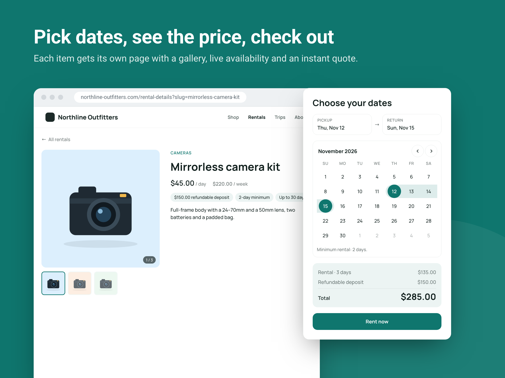
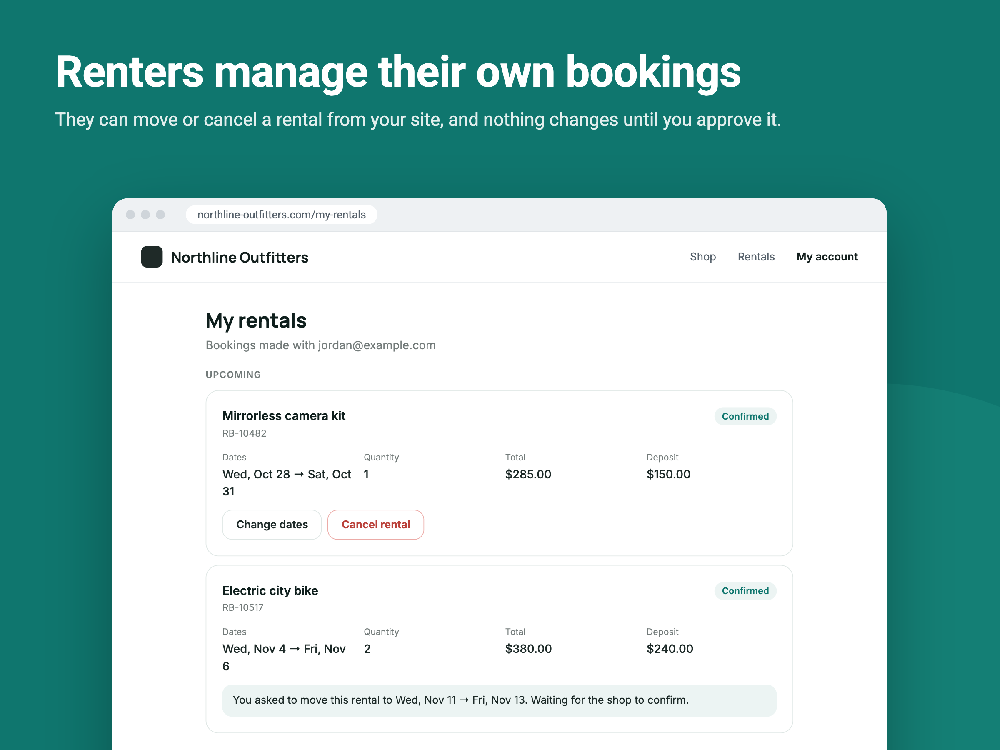

# Rental Manager: App Market listing

Copy for **Dev Center → App Profile**, plus the media in this folder. Each section names the Dev Center page it belongs on, and follows Wix's [App Info](https://dev.wix.com/docs/build-apps/launch-your-app/market-listing/add-your-app-info) and [Media](https://dev.wix.com/docs/build-apps/launch-your-app/market-listing/add-your-media) guidelines.

---

## App Info (App Profile → App Info)

### App name

**Rental Manager**

> Search the App Market before submitting to confirm the name is free. Alternatives if it's taken: *Rent Desk*, *Rentable*, *Hire Hub*. The name is in title case and doesn't include "Wix", prices or generic adjectives, as the guidelines ask.

### Teaser

> Rent out equipment by the day or week with live availability, deposits and online checkout.

*(91 characters. It speaks to the user and doesn't mention Wix, the company or other apps.)*

### App icon

[`icon.png`](icon.png): 1,000 × 1,000 px, 24-bit PNG (no alpha), sRGB. It's a simple graphic on a solid teal background, with no frame, text, screenshot or business name. Wix rounds the corners.

### Features

1. Visitors pick dates on a live availability calendar and pay at checkout
2. Daily and weekly rates, refundable deposits and minimum rental lengths
3. Renters move or cancel bookings from their account, with your approval
4. Today's pickups, returns and overdue rentals in one dashboard view
5. A rental catalog and item pages that match your site design

### Full description

Rent out cameras, tools, outdoor gear, party equipment or anything else you own, straight from your site. Add items with daily and weekly rates, deposits and unit counts, and visitors browse a rental catalog, pick dates on a live availability calendar and pay at checkout. Double bookings are blocked automatically. Renters can move or cancel a booking from their account, with your approval, and get email updates. Track pickups, returns and overdue items from your dashboard.

*(477 characters, under the 500 shown before "Read more". No bullets or bold, as the guidelines ask.)*

**Compatibility, to state in the listing if Wix asks:** checkout runs through Wix eCommerce. The **My Rentals** widget, where renters manage their bookings, needs the Wix Members Area on the site.

### Wix demo site URL

`TODO`: a published Wix site with the Rental Catalog, Rental Details and My Rentals widgets, and a few items with real photos.

### Terms & conditions URL

`TODO`: required. It's shown to site owners in the install consent flow.

---

## Media (App Profile → Media)

### Images

Upload in this order, so they tell the story from visitor to owner. All are 2,400 × 1,800 px PNG (4:3, above the 1,200 × 900 minimum), with white Roboto text on one solid background, the brand teal `#0F766E` from the icon.

| # | File | Shows |
|---|---|---|
| 1 | [`images/01-main.png`](images/01-main.png) | **Main image.** App name, tagline, three key benefits and the rental catalog on a site |
| 2 | [`images/02-item-page.png`](images/02-item-page.png) | The item page with dates picked and the price breakdown |
| 3 | [`images/03-my-rentals.png`](images/03-my-rentals.png) | The My Rentals widget: a renter's upcoming bookings, change and cancel buttons, and a date change waiting for approval |
| 4 | [`images/04-dashboard.png`](images/04-dashboard.png) | The dashboard's Today board with the sidebar: pickups, returns, overdue, awaiting approval |
| 5 | [`images/05-themes.png`](images/05-themes.png) | Customization: the same catalog in the Classic, Warm and Night themes |
| 6 | [`images/06-mobile.png`](images/06-mobile.png) | Mobile view: two-column catalog and the booking form on a phone |

This matches the guidance for website apps: the app on a site in images 1–3, the dashboard in 4, customization in 5 and the mobile view in 6. Each image shows the app in use, with short text and no sales or discount wording.

These are the app's real widgets and dashboard rendered with demo data. *Northline Outfitters* is a fictional store, and the products are illustrations. The earlier catalog-only image is in [`images/unused/`](images/unused/) in case you want it back.

### Video (recommended)

`TODO`: a YouTube URL. Keep it a 30–60 second promotional overview, not a tutorial:

1. A visitor browses the catalog and opens an item (about 8 s)
2. They pick dates, the price appears, they press **Rent now** and land in checkout (about 12 s)
3. Later, in **My Rentals**, they ask to move the booking (about 8 s)
4. The owner approves the change from the dashboard, and the renter gets the email (about 10 s)
5. The owner's Today board: they mark a pickup done (about 8 s)
6. Restyling the catalog in the Editor with a theme preset (about 6 s)
7. End card with the app icon and name

### Promotional banner (optional)

[`banner.jpg`](banner.jpg): 540 × 360 px JPG. It uses the brand-colour background (not white), with no text, no app name and no logo, as the spec requires. The name, teaser and logo appear below it in the App Market.

---

## Get Found (App Profile → App Market → Get Found)

**Category:** Services & Events

**Search keywords (5):**

1. rentals
2. equipment rental
3. booking calendar
4. deposits
5. hire

---

## Before submitting

- [ ] Confirm the app name is available in the App Market
- [ ] Publish the demo site and add its URL
- [ ] Add the terms & conditions URL
- [ ] Record and upload the promo video (optional)
- [ ] In **App Profile → App Audience → Required Wix products**, select **Wix Members Area**, so Wix won't let a site install the app without it
- [ ] Add the app permissions: **Manage Email Marketing** (`SCOPE.DC-PROMOTE.EMAIL-MARKETING`), **Read Members** (`SCOPE.DC-MEMBERS.READ-MEMBERS`), **Read Site Owner Email**, **Manage Your App** (`SCOPE.DC.MANAGE-YOUR-APP`), plus `SCOPE.DEV_CENTER.INSTALL-APPS` for the dashboard's Members Area install action
- [ ] Check that the plan limits described in pricing match `src/rental/plans.ts`: Basic (1 item, 10 bookings/month), Pro (30 items, 150 bookings/month, manual approval), Business (unlimited, per-item rules, calendar)
