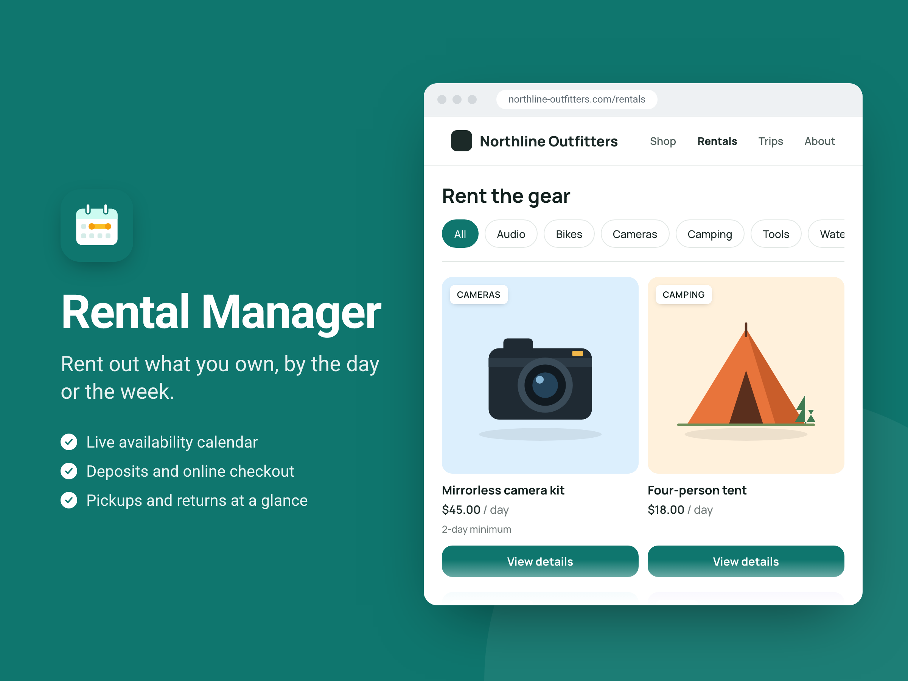
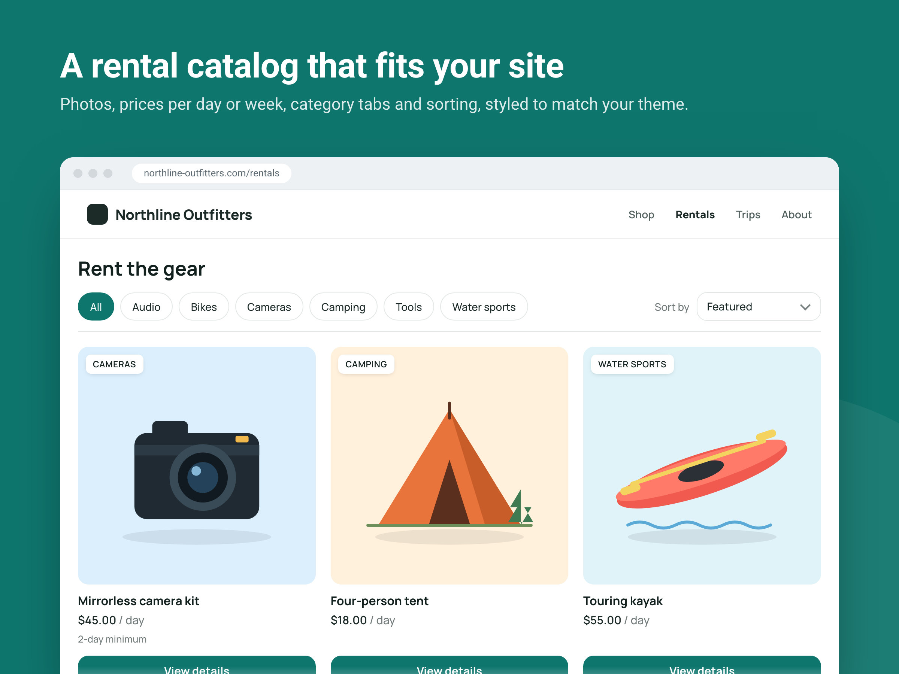
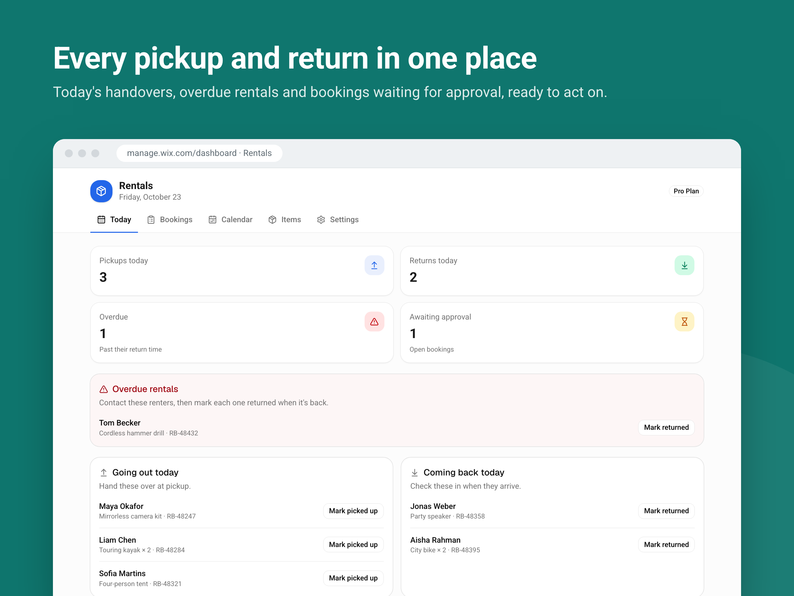
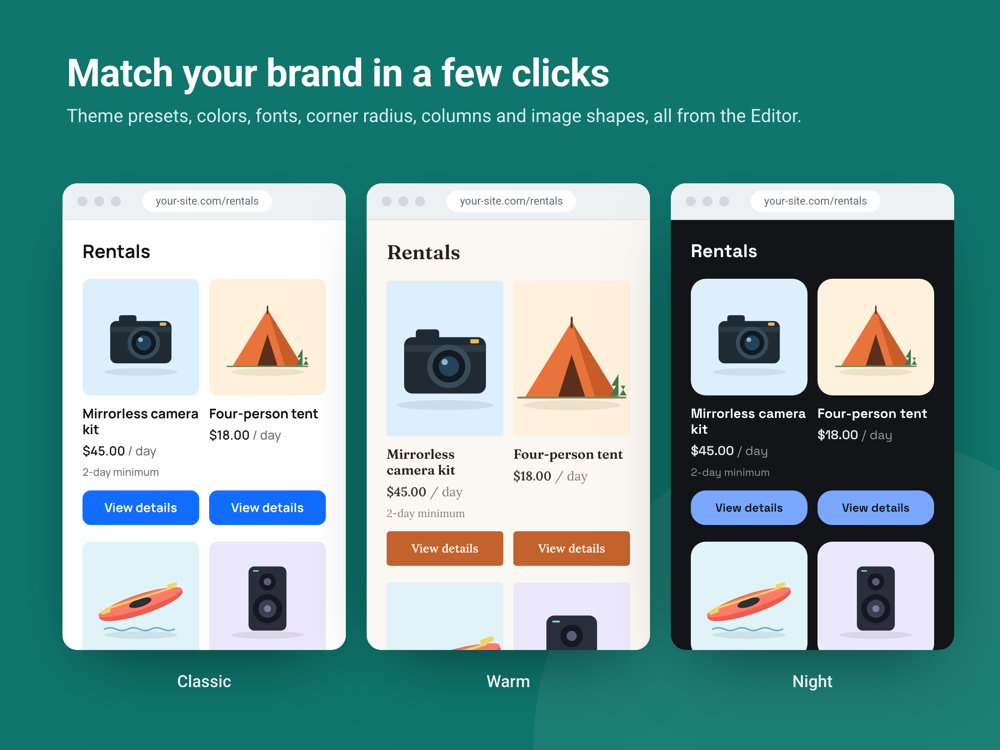
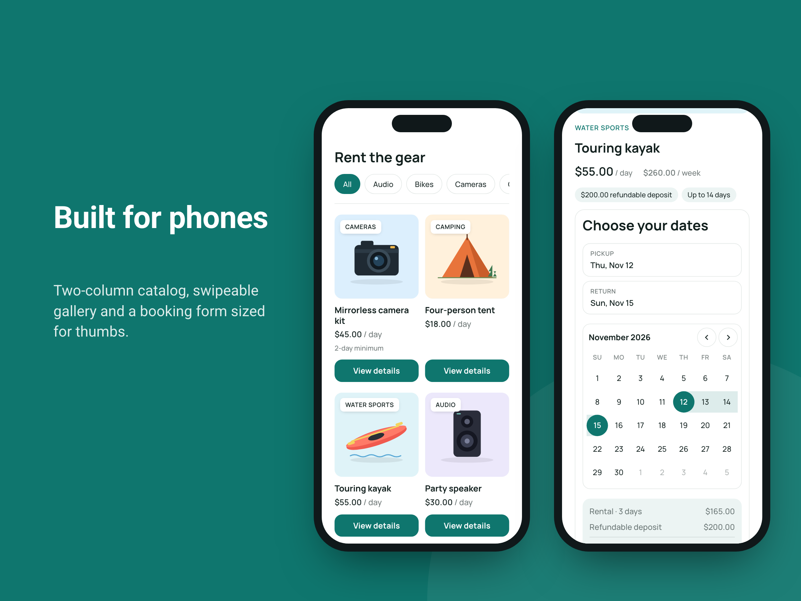
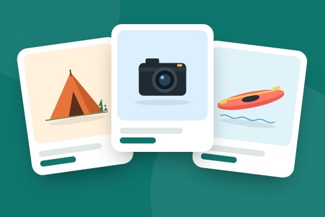

# Rental Manager: App Market listing

Copy for **Dev Center → App Profile**, plus the media in this folder. Each section names the Dev Center page it belongs on.

---

## App Info (App Profile → App Info)

### App name

**Rental Manager**

> Search the App Market before submitting to confirm the name is free. Alternatives if it's taken: *Rent Desk*, *Rentable*, *Hire Hub*.

### Teaser

> Rent out equipment by the day or week with live availability, deposits and online checkout.

### App icon

[`icon.png`](icon.png): 1,000 × 1,000 px, 24-bit PNG, sRGB. Solid background with no frame or text. Wix rounds the corners.

### Features

1. Visitors pick dates on a live availability calendar and pay at checkout
2. Daily and weekly rates, refundable deposits and minimum rental lengths
3. A store-style rental catalog and item pages that match your site design
4. Today's pickups, returns and overdue rentals in one dashboard view
5. Turn existing store products into rentals

### Full description

Rent out cameras, tools, outdoor gear, party equipment or anything else you own, straight from your site. Add your items with daily and weekly rates, deposits and how many units you have, and visitors can browse a rental catalog, choose dates on a live availability calendar and pay through your existing checkout. Double bookings are prevented automatically, with buffer days between rentals. Track pickups, returns and overdue items from your dashboard, and approve bookings yourself when you want.

*(About 480 characters, under the 500 shown before "Read more". No bullets, as the guidelines ask.)*

### Wix demo site URL

`TODO`: a published Wix site with the Rental Catalog and Rental Details widgets and a few items with real photos.

### Terms & conditions URL

`TODO`: required. It's shown to site owners in the install consent flow.

---

## Media (App Profile → Media)

### Images

Upload in this order. All are 2,400 × 1,800 px (4:3, above the 1,200 × 900 minimum), PNG, sRGB, with Roboto text on the brand teal `#0F766E`.

| # | File | Shows |
|---|---|---|
| 1 | [`images/01-main.png`](images/01-main.png) | **Main image.** App name, tagline, three key benefits and the catalog on a site |
| 2 | [`images/02-catalog.png`](images/02-catalog.png) | The rental catalog on a site: photos, category tabs, sort, prices |
| 3 | [`images/03-item-page.png`](images/03-item-page.png) | The item page with a date range picked and the price breakdown |
| 4 | [`images/04-dashboard.png`](images/04-dashboard.png) | The dashboard's Today board: pickups, returns, overdue, awaiting approval |
| 5 | [`images/05-themes.png`](images/05-themes.png) | The same catalog in the Classic, Warm and Night themes |
| 6 | [`images/06-mobile.png`](images/06-mobile.png) | Mobile view: two-column catalog and the booking form on a phone |

These are the app's real widgets and dashboard rendered with demo data. *Northline Outfitters* is a fictional store, and the products are illustrations.

### Video (recommended)

`TODO`: a YouTube URL. Keep it a 30–60 second promo, not a tutorial:

1. A visitor browses the catalog and opens an item (about 10 s)
2. They pick dates, the price appears, they press **Rent now** and land in checkout (about 15 s)
3. The owner's Today board shows the booking and they mark it picked up (about 15 s)
4. Restyling the catalog in the Editor with a theme preset (about 10 s)
5. End card with the app icon and name

### Promotional banner (optional)

[`banner.jpg`](banner.jpg): 540 × 360 px JPG. Brand-color background with no text and no logo, as the spec requires.

---

## Get Found (App Profile → App Market → Get Found)

**Category:** Services & Events

**Search keywords (5):**

1. rentals
2. equipment rental
3. booking calendar
4. deposits
5. hire

---

## Before submitting

- [ ] Confirm the app name is available in the App Market
- [ ] Publish the demo site and add its URL
- [ ] Add the terms & conditions URL
- [ ] Record and upload the promo video (optional)
- [ ] Check that the plan limits described in pricing match `src/rental/plans.ts`: Free (3 items, 10 bookings/month), Starter (25 items, 150 bookings/month, manual approval), Pro (unlimited, per-item rules, calendar)
